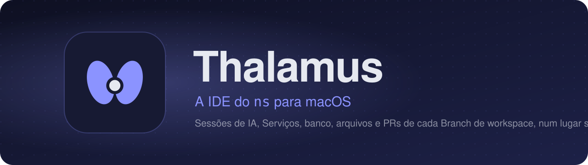
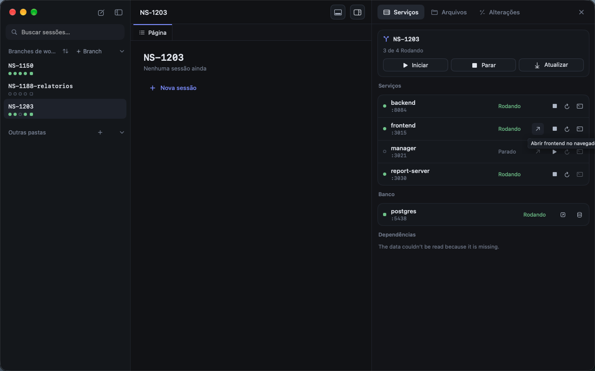
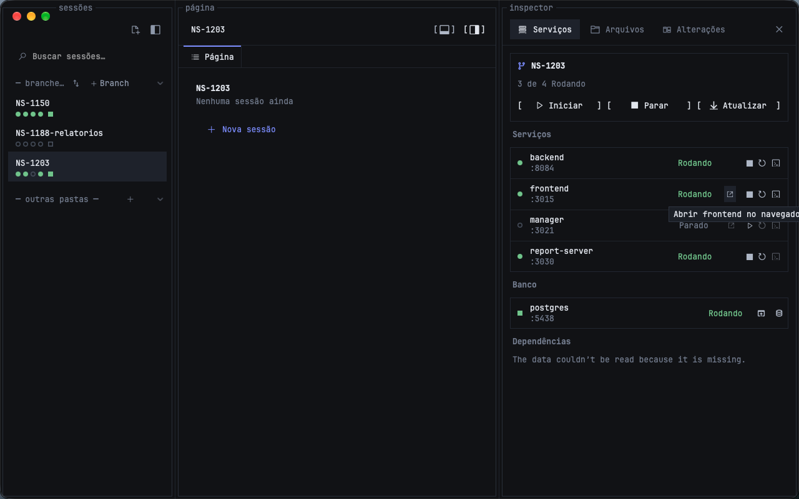

<p align="center">
  
</p>

<p align="center">
  
  
  
</p>

<br>

<p align="center">
  O Thalamus é a interface do <a href="https://github.com/bMoki/neurosteps-cli"><b><code>ns</code></b></a>, a CLI do NeuroSteps<br>
  que dá a cada branch git um ambiente isolado: worktrees dos repos, banco PostgreSQL próprio,<br>
  serviços no ar e endereços locais. O Thalamus põe tudo isso, e o agente de IA, numa janela só.
</p>

<br>

<p align="center">
  
</p>

<br>

<table>
  <tr>
    <td width="50%" valign="top">
      <h3>🧠 Sessões de IA</h3>
      Claude Code e OpenCode, ancorados na pasta da branch, com o estado de cada conversa à vista.
    </td>
    <td width="50%" valign="top">
      <h3>🌿 Branches de workspace</h3>
      Criadas e preparadas pelo <code>ns</code>: repos, banco e dependências num clique.
    </td>
  </tr>
  <tr>
    <td valign="top">
      <h3>⚡ Serviços</h3>
      Backend, frontend e banco no ar, com console interativo e snapshots.
    </td>
    <td valign="top">
      <h3>🔀 Arquivos, terminais e PRs</h3>
      Editor, diff, terminais e o estado dos PRs de cada branch, sem sair do app.
    </td>
  </tr>
</table>

<br>

<p align="center">
  
  <br>
  <sub>Estilo TTY</sub>
</p>

## Começando

```sh
Scripts/dev-ns setup     # ns em desenvolvimento + workspace de teste
open Thalamus.xcodeproj  # rode o esquema "Thalamus"
```

Precisa do macOS 26.6+, do Xcode 26.6 e do [`neurosteps-cli`](https://github.com/bMoki/neurosteps-cli) em `../cli`.
O resto está em [docs/fluxo.md](docs/fluxo.md).

<br>

<p align="center">
  
  <br>
  <sub>Nascido como fork do <a href="https://github.com/Gabriel-Passoss/Den">Den</a>, de Gabriel Passos.</sub>
</p>
